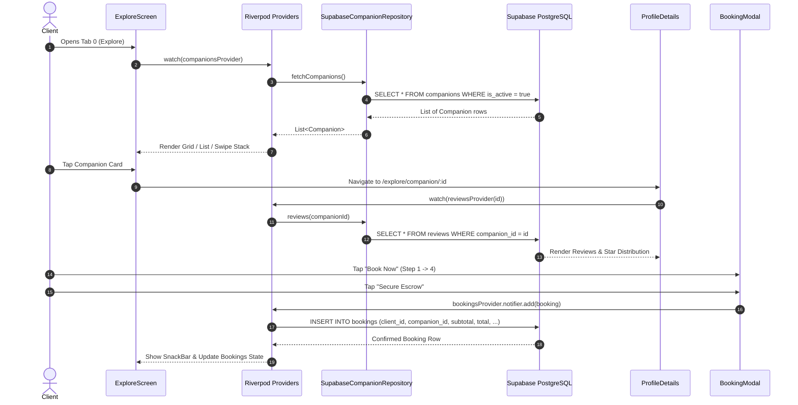

# Tab 1: Explore & Booking Engine — Full Implementation Plan

## 1. Overview & Objectives
Tab 1 serves as the primary marketplace discovery surface for **Friendify**. Clients discover verified platonic companions, filter by activity and rate, review past experiences, and execute a 4-step escrow-secured booking.

---

## 2. Architecture & Data Flow



---

## 3. UI Component Breakdown & File Mapping

| Screen / Widget | File Location | Key Responsibility |
| :--- | :--- | :--- |
| **`ExploreScreen`** | [explore_screen.dart](file:///d:/Android%20Projects/friendify/lib/screens/explore_screen.dart) | Search bar, horizontal activity chips, view mode segmented button (Grid, List, Stack), pull-to-refresh. |
| **`FilterBottomSheet`** | [filter_bottom_sheet.dart](file:///d:/Android%20Projects/friendify/lib/widgets/filter_bottom_sheet.dart) | Location input, activity selector, rate range slider ($0–$200+), minimum star rating. |
| **`ProfileDetailsScreen`** | [profile_details_screen.dart](file:///d:/Android%20Projects/friendify/lib/screens/profile_details_screen.dart) | Gallery carousel, verified badges, bio, languages, skills tags, transparent pricing card, reviews breakdown. |
| **`_AddReviewDialog`** | [profile_details_screen.dart](file:///d:/Android%20Projects/friendify/lib/screens/profile_details_screen.dart) | Interactive star rating selector, experience text field, submit review action. |
| **`BookingModal`** | [booking_modal.dart](file:///d:/Android%20Projects/friendify/lib/screens/booking_modal.dart) | 4-step wizard: Date/Time $\rightarrow$ Duration/Activity $\rightarrow$ Location $\rightarrow$ Escrow Payment Summary. |
| **`BookingSummary`** | [booking_summary.dart](file:///d:/Android%20Projects/friendify/lib/widgets/booking_summary.dart) | Financial line items: Subtotal, 15% Platform Escrow Fee, Total. |

---

## 4. State Management (Riverpod) Pipeline

### A. Feed & Filtering Providers (`companion_provider.dart`)
1. **`allCompanionsProvider`**:
   `FutureProvider<List<Companion>>((ref) => ref.watch(companionRepositoryProvider).fetchCompanions())`
2. **`filterProvider`**:
   `NotifierProvider<FilterNotifier, CompanionFilter>` holding:
   - `query`: Text query string (matches name, bio, tags).
   - `location`: City name filter.
   - `activity`: Selected activity chip (e.g. `Coffee`, `Gym Buddy`).
   - `minRate` & `maxRate`: Hourly price range.
   - `minRating`: Minimum average rating threshold.
3. **`companionsProvider`**:
   `Provider<AsyncValue<List<Companion>>>` reacting to changes in `allCompanionsProvider` and `filterProvider`.
4. **`viewModeProvider`**:
   Manages `ViewModeType` (`grid`, `list`, `stack`).

### B. Profile & Review Providers
1. **`companionByIdProvider(id)`**: Loads companion details by ID.
2. **`reviewsProvider(companionId)`**: Loads all reviews for a companion.
3. **`submitReview(ref, companionId, review)`**:
   Submits review, invalidates `reviewsProvider`, `companionByIdProvider`, and `allCompanionsProvider`.

### C. Booking Provider (`booking_provider.dart`)
1. **`bookingsProvider`**:
   `NotifierProvider<BookingsNotifier, List<Booking>>` — handles `add(booking)`, `cancel(id)`, `complete(id)`, and pull-to-refresh sync.

---

## 5. Supabase Database Integration

### Tables & SQL Relations
1. **`public.companions`**:
   ```sql
   SELECT id, name, age, city, bio, avatar_url, gallery, hourly_rate, 
          rating, review_count, distance_km, verified, background_checked, 
          languages, tags, activities, badges, is_active
   FROM public.companions
   WHERE is_active = true;
   ```
2. **`public.reviews`**:
   ```sql
   INSERT INTO public.reviews (companion_id, author_id, author_name, rating, text)
   VALUES (:companionId, :authorId, :authorName, :rating, :text);
   ```
   *Trigger*: `trg_recalculate_companion_rating` automatically computes the new average rating and review count.
3. **`public.bookings`**:
   ```sql
   INSERT INTO public.bookings (
       client_id, companion_id, start_time, hours, 
       activity, location, status, subtotal, total
   ) VALUES (
       :clientId, :companionId, :startTime, :hours,
       :activity, :location, 'confirmed', :subtotal, :total
   );
   ```

---

## 6. Implementation & Validation Checklist
- [x] Live companion directory fetching from Supabase (`fetchCompanions`).
- [x] Multi-parameter search and filtering (query, city, activity, rate, rating).
- [x] View modes switching (Grid, List, Swipe Stack).
- [x] Pull-to-refresh sync using `RefreshIndicator`.
- [x] Photo gallery carousel with interactive page indicator.
- [x] Zero-division protection on empty reviews (`NaN` fix).
- [x] Review submission inserting into `public.reviews` with automatic rating recalculation.
- [x] 4-step booking modal with responsive non-overflowing buttons.
- [x] Booking record persistence into `public.bookings` with 15% escrow fee calculation.
