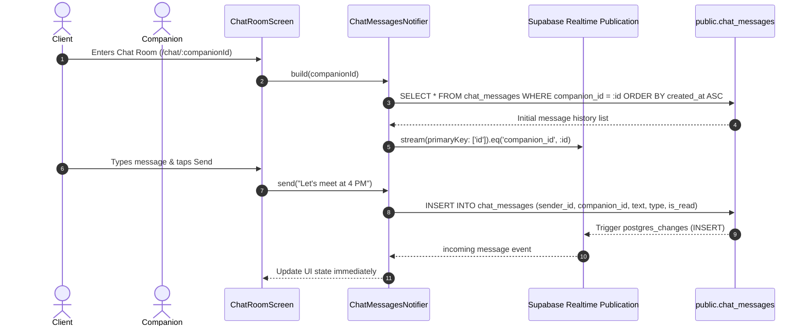

# Tab 2: Realtime Chat & Inbox — Full Implementation Plan

## 1. Overview & Objectives
Tab 2 delivers an interactive, real-time communication platform for clients and companions. It features an active message inbox, real-time message broadcasting via Supabase Realtime Channels, message serialization for location and voice payloads, and emergency safety integration.

---

## 2. Architecture & Realtime Stream Pipeline



---

## 3. UI Component Breakdown & File Mapping

| Screen / Widget | File Location | Key Responsibility |
| :--- | :--- | :--- |
| **`ChatInboxScreen`** | [chat_screen.dart](file:///d:/Android%20Projects/friendify/lib/screens/chat_screen.dart) | Thread cards with avatar, online indicator dot, booking status pill, latest message snippet, unread counter badge. |
| **`ChatRoomScreen`** | [chat_screen.dart](file:///d:/Android%20Projects/friendify/lib/screens/chat_screen.dart) | Chat bubble stream, message composer input, action buttons for Location sharing, Voice note simulation, and Safety SOS modal. |
| **`_LocationBubble`** | [chat_screen.dart](file:///d:/Android%20Projects/friendify/lib/screens/chat_screen.dart) | Map preview tile with venue name and open map link. |
| **`_VoiceBubble`** | [chat_screen.dart](file:///d:/Android%20Projects/friendify/lib/screens/chat_screen.dart) | Interactive audio player simulation with waveform, play/pause toggle, and duration counter. |
| **`SafetyBanner` / SOS** | [safety_banner.dart](file:///d:/Android%20Projects/friendify/lib/widgets/safety_banner.dart) | Top safety reminder and SOS modal sheet dispatch. |

---

## 4. State Management (Riverpod) Pipeline

### A. Repository Provider (`chat_provider.dart`)
- **`chatRepositoryProvider`**:
  Initializes `SupabaseChatRepository(client)` when configured; falls back to `MockChatRepository` in offline environments.

### B. Message Stream Notifier (`ChatMessagesNotifier`)
- **`chatMessagesProvider(companionId)`**:
  - `AutoDisposeFamilyNotifier<List<ChatMessage>, String>`
  - Sets up `StreamSubscription<ChatMessage>` to `repo.messageStream(companionId)`.
  - Automatically cancels subscription when user exits the chat room (`ref.onDispose`).
  - Provides `send(text, {type, payload})` method.

### C. Inbox Threads Provider (`companion_provider.dart`)
- **`threadsProvider`**:
  - Queries active companions from `allCompanionsProvider`.
  - Maps companion active status (`is_active`) to the live green dot.
  - Dynamically sets booking status and last message prompt.

---

## 5. Supabase Database Integration

### Table Schema (`public.chat_messages`)
```sql
CREATE TABLE IF NOT EXISTS public.chat_messages (
    id UUID PRIMARY KEY DEFAULT uuid_generate_v4(),
    sender_id UUID REFERENCES public.profiles(id) ON DELETE CASCADE,
    receiver_id UUID REFERENCES public.profiles(id) ON DELETE CASCADE,
    companion_id UUID REFERENCES public.companions(id) ON DELETE SET NULL,
    text TEXT NOT NULL,
    type message_type NOT NULL DEFAULT 'text', -- 'text' | 'voice' | 'location'
    payload JSONB,
    is_read BOOLEAN NOT NULL DEFAULT false,
    created_at TIMESTAMPTZ NOT NULL DEFAULT NOW()
);
```

### Realtime Publication
```sql
ALTER PUBLICATION supabase_realtime ADD TABLE public.chat_messages;
```

### Message Payload Types
1. **Text Message**:
   `{ "type": "text", "text": "Hello Maya!" }`
2. **Location Snippet**:
   `{ "type": "location", "text": "Blue Tokai Cafe, Bandra", "payload": { "lat": 19.0596, "lng": 72.8295, "venue": "Blue Tokai Cafe" } }`
3. **Voice Note**:
   `{ "type": "voice", "text": "Voice note (0:14)", "payload": { "duration_sec": 14 } }`

---

## 6. Implementation & Validation Checklist
- [x] Chat inbox displays companion threads dynamically.
- [x] Supabase Realtime channel stream subscribed in `SupabaseChatRepository`.
- [x] Relaxed `sender_id` and `receiver_id` foreign keys in `v2_fix_migration.sql` to support guest/companion conversations.
- [x] Message serialization handles `text`, `location`, and `voice` types with JSON payloads.
- [x] Safety SOS modal accessible from chat room header.
- [x] Message stream closes subscriptions on screen disposal to prevent memory leaks.
