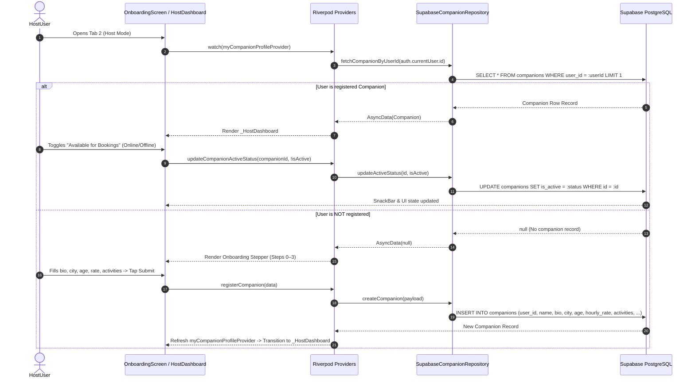

# Tab 3: Host Mode & Management Dashboard — Full Implementation Plan

## 1. Overview & Objectives
Tab 3 serves as the dual-purpose onboarding and management portal for companions in **Friendify**.
- **For Non-Hosts**: Provides an engaging "Become a Host" onboarding funnel (activity preferences, hourly rate selection, bio, location, age, and identity verification checklist).
- **For Registered Hosts**: Automatically detects the user's companion profile and presents a live **Host Management Dashboard** featuring:
  - Online/Offline availability toggle persisting to `public.companions.is_active`.
  - Escrow earnings & wallet balance overview.
  - Interactive hourly rate editor (`hourly_rate` in Supabase).
  - Public listing preview linking directly to the companion's profile.
  - Booking requests and confirmed schedule management.

---

## 2. Architecture & Data Flow



---

## 3. UI Component Breakdown & File Mapping

| Screen / Widget | File Location | Key Responsibility |
| :--- | :--- | :--- |
| **`OnboardingScreen`** | [onboarding_screen.dart](file:///d:/Android%20Projects/friendify/lib/screens/onboarding_screen.dart) | Root container; checks `myCompanionProfileProvider` and conditionally renders `_HostDashboard` or `_buildHostOnboardingFlow`. |
| **`_HostDashboard`** | [onboarding_screen.dart](file:///d:/Android%20Projects/friendify/lib/screens/onboarding_screen.dart) | Live companion management interface: profile header, online switch, escrow wallet balance, rate adjuster slider, listing preview button. |
| **`_FindFriendLanding`** | [onboarding_screen.dart](file:///d:/Android%20Projects/friendify/lib/screens/onboarding_screen.dart) | Value proposition card shown when user chooses "Find a Friend" segment; includes "Apply as Host" call-to-action. |
| **`_buildHostOnboardingFlow`** | [onboarding_screen.dart](file:///d:/Android%20Projects/friendify/lib/screens/onboarding_screen.dart) | 4-step wizard: Step 0 (Bio & City & Age), Step 1 (Activities & Hourly Rate), Step 2 (Verification Checklist), Step 3 (Schedule & Launch). |
| **`CompanionCard`** | [companion_card.dart](file:///d:/Android%20Projects/friendify/lib/widgets/companion_card.dart) | Reusable preview component rendering how the host appears publicly to clients. |

---

## 4. State Management (Riverpod) Pipeline

### A. Host Detection & Profile Providers (`companion_provider.dart`)
1. **`myCompanionProfileProvider`**:
   - Type: `FutureProvider<Companion?>`
   - Watches `authProvider`. If unauthenticated, returns `null`.
   - Queries `companionRepositoryProvider.fetchCompanionByUserId(auth.user.id)`.
   - Auto-invalidated upon successful host profile creation or update.

2. **`hostModeProvider`**:
   - Type: `StateNotifier<bool>`
   - Toggles UI mode between "Find a Friend" (browse info) and "Become a Host" (onboarding stepper).

### B. Host Management Mutators (`companion_provider.dart` & `repositories.dart`)
1. **`updateCompanionActiveStatus(String companionId, bool isActive)`**:
   - Calls `SupabaseCompanionRepository.updateActiveStatus(companionId, isActive)`.
   - Executes SQL: `UPDATE companions SET is_active = :isActive WHERE id = :companionId`.
   - Optimistically updates local Riverpod state and triggers UI feedback.

2. **`updateCompanionHourlyRate(String companionId, double newRate)`**:
   - Calls `SupabaseCompanionRepository.updateHourlyRate(companionId, newRate)`.
   - Executes SQL: `UPDATE companions SET hourly_rate = :newRate WHERE id = :companionId`.
   - Refreshes `allCompanionsProvider` and `myCompanionProfileProvider`.

3. **`registerCompanionProfile(Map<String, dynamic> data)`**:
   - Validates user authentication.
   - Inserts row into `public.companions` with `user_id = auth.currentUser.id`.
   - Updates `public.profiles.is_companion = true`.

---

## 5. Supabase Schema & Database Integration

### A. Table: `public.companions`
```sql
CREATE TABLE IF NOT EXISTS public.companions (
    id UUID PRIMARY KEY DEFAULT gen_random_uuid(),
    user_id UUID REFERENCES auth.users(id) ON DELETE CASCADE,
    name TEXT NOT NULL,
    age INT NOT NULL DEFAULT 24,
    city TEXT NOT NULL DEFAULT 'Mumbai',
    rating NUMERIC(3, 2) DEFAULT 5.0,
    review_count INT DEFAULT 0,
    hourly_rate NUMERIC(10, 2) NOT NULL DEFAULT 25.0,
    bio TEXT,
    avatar_url TEXT,
    images TEXT[] DEFAULT ARRAY[]::TEXT[],
    activities TEXT[] DEFAULT ARRAY[]::TEXT[],
    languages TEXT[] DEFAULT ARRAY['English']::TEXT[],
    is_active BOOLEAN DEFAULT TRUE,
    created_at TIMESTAMPTZ DEFAULT NOW(),
    updated_at TIMESTAMPTZ DEFAULT NOW()
);
```

### B. Table: `public.profiles`
```sql
ALTER TABLE public.profiles ADD COLUMN IF NOT EXISTS is_companion BOOLEAN DEFAULT FALSE;
```

---

## 6. Implementation Checklist & Verification Criteria

- [x] Host status automatic detection (`myCompanionProfileProvider` returns live companion record or null).
- [x] Dual-state screen switching (renders `_HostDashboard` for registered hosts, onboarding stepper for new users).
- [x] Real-time online/offline switch persisting to Supabase `companions.is_active`.
- [x] Hourly rate dynamic slider persisting changes to Supabase `companions.hourly_rate`.
- [x] Live Escrow earnings card connected to `walletProvider`.
- [x] "Preview Public Listing" button routing to `/explore/companion/:id`.
- [x] Multi-step onboarding flow with dynamic Bio, City, and Age inputs.
- [x] Authentication guard alerting guest users to sign in before publishing.
- [x] Riverpod cross-tab state invalidation (updating companion in Tab 3 immediately updates Tab 1 Explore feed).

---

## 7. Edge Cases & Error Handling

1. **Guest User Completing Host Application**:
   - Stepper checks `auth.isAuthenticated` before Step 3 submission.
   - Displays SnackBar with direct `context.push('/auth')` button to ensure data isn't lost.
2. **Network Timeout during Rate/Status Update**:
   - `try-catch` blocks in repository revert optimistic state and display descriptive error SnackBars.
3. **User Profile Image Fallback**:
   - If companion has no avatar URL uploaded, falls back to high-resolution default avatar with initials.
