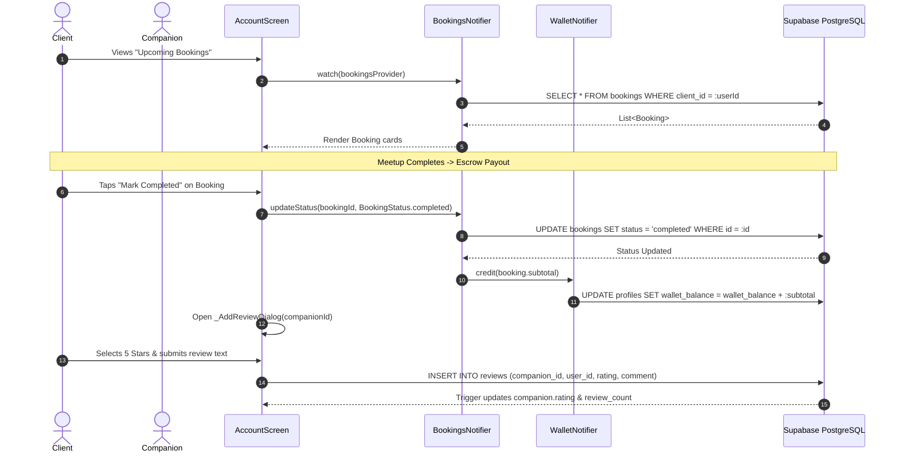

# Tab 4: Account, Wallet & Safety Center — Full Implementation Plan

## 1. Overview & Objectives
Tab 4 acts as the user control center for **Friendify**, consolidating identity management, financial escrow transactions, complete booking lifecycle handling, emergency safety nets, and application customization.
- **Identity & Auth**: Seamless switching between Guest Mode and Supabase authenticated profiles (`auth.users` & `public.profiles`).
- **Escrow Wallet**: Real-time balance sync with simulated Stripe payout/withdrawal workflows.
- **Bookings Lifecycle Manager**: Triple-filtered views (`Upcoming`, `Past`, `Canceled`) with live actions:
  - Cancel booking before start time.
  - Mark completed upon meetup conclusion (which releases escrow funds to the host).
  - Submit verified star reviews & feedback.
- **Emergency Contacts CRUD**: Save and manage personal emergency phone contacts stored in Supabase `emergency_contacts`.
- **Safety Center & SOS**: Instant access to safety guidelines, code of conduct, and 1-tap SOS alerts.

---

## 2. Architecture & Data Flow



---

## 3. UI Component Breakdown & File Mapping

| Screen / Widget | File Location | Key Responsibility |
| :--- | :--- | :--- |
| **`AccountScreen`** | [account_screen.dart](file:///d:/Android%20Projects/friendify/lib/screens/account_screen.dart) | Main view; handles tab bar, pull-to-refresh, profile header, wallet summary, bookings, safety contacts, and app preferences. |
| **`AuthScreen`** | [auth_screen.dart](file:///d:/Android%20Projects/friendify/lib/screens/auth_screen.dart) | Email/Password login, new user registration, and one-tap guest mode entry. |
| **`WalletCard`** | [account_screen.dart](file:///d:/Android%20Projects/friendify/lib/screens/account_screen.dart) | Displays current balance, escrow status, and triggers simulated payout withdrawals. |
| **`BookingItemCard`** | [account_screen.dart](file:///d:/Android%20Projects/friendify/lib/screens/account_screen.dart) | Renders companion avatar, booking date/time, hourly total, status pill, and action buttons (Cancel, Complete, Rate). |
| **`EmergencyContactsSection`** | [account_screen.dart](file:///d:/Android%20Projects/friendify/lib/screens/account_screen.dart) | List of configured contacts with swipe-to-delete and dialog to add new emergency contacts. |
| **`SafetyBanner` / SOS** | [safety_banner.dart](file:///d:/Android%20Projects/friendify/lib/widgets/safety_banner.dart) | Quick safety alerts, live location sharing toggle, and high-priority emergency dispatch modal. |

---

## 4. State Management (Riverpod) Pipeline

### A. Authentication State (`auth_provider.dart`)
1. **`authProvider`**:
   - `StateNotifier<AuthState>`
   - Binds to `Supabase.instance.client.auth.onAuthStateChange`.
   - Supports `signInWithEmail(email, password)`, `signUpWithEmail(email, password, name)`, `continueAsGuest()`, and `signOut()`.
   - Exposes `currentUser` (`id`, `displayName`, `email`, `isCompanion`, `avatarUrl`).

### B. Bookings Lifecycle (`booking_provider.dart`)
1. **`bookingsProvider`**:
   - `StateNotifier<List<Booking>>`
   - Initialized via `SupabaseBookingRepository.fetchBookings(userId)`.
   - Key methods:
     - `addBooking(Booking b)`: Persists new booking record to Supabase.
     - `cancelBooking(String bookingId)`: Updates status to `canceled`.
     - `completeBooking(String bookingId)`: Updates status to `completed` and releases escrow payout.
     - `refresh()`: Re-fetches the latest booking rows from PostgreSQL.

### C. Wallet & Escrow Balance (`booking_provider.dart`)
1. **`walletProvider`**:
   - `StateNotifier<double>`
   - Synchronizes with `public.profiles.wallet_balance`.
   - Methods: `credit(amount)` (upon completed booking), `withdraw()` (initiates payout).

### D. Emergency Contacts (`booking_provider.dart`)
1. **`contactsProvider`**:
   - `StateNotifier<List<String>>`
   - Persists contacts to `public.emergency_contacts` table.
   - Methods: `add(contactString)`, `remove(index)`.

---

## 5. Supabase Schema & Database Integration

### A. Table: `public.bookings`
```sql
CREATE TABLE IF NOT EXISTS public.bookings (
    id UUID PRIMARY KEY DEFAULT gen_random_uuid(),
    client_id UUID REFERENCES auth.users(id) ON DELETE SET NULL,
    companion_id UUID REFERENCES public.companions(id) ON DELETE CASCADE,
    start_time TIMESTAMPTZ NOT NULL,
    hours INT NOT NULL DEFAULT 1,
    subtotal NUMERIC(10, 2) NOT NULL,
    fee NUMERIC(10, 2) NOT NULL,
    total NUMERIC(10, 2) NOT NULL,
    status TEXT NOT NULL DEFAULT 'confirmed' CHECK (status IN ('pending', 'confirmed', 'completed', 'canceled')),
    activity TEXT NOT NULL,
    location TEXT NOT NULL,
    created_at TIMESTAMPTZ DEFAULT NOW()
);
```

### B. Table: `public.emergency_contacts`
```sql
CREATE TABLE IF NOT EXISTS public.emergency_contacts (
    id UUID PRIMARY KEY DEFAULT gen_random_uuid(),
    user_id UUID REFERENCES auth.users(id) ON DELETE CASCADE,
    name TEXT NOT NULL,
    phone TEXT NOT NULL,
    created_at TIMESTAMPTZ DEFAULT NOW()
);
```

---

## 6. Implementation Checklist & Verification Criteria

- [x] Guest mode vs. Authenticated profile dynamic header card rendering.
- [x] Sign In / Sign Out confirmation flow with clean state reset.
- [x] Live Wallet balance display with zero hardcoded default balance (`$0.00`).
- [x] Withdrawal button disabled on zero balance; triggers payout flow when balance > 0.
- [x] Segmented Bookings filter: `Upcoming`, `Past`, and `Canceled`.
- [x] Booking state machine transitions (`confirmed` $\rightarrow$ `completed` or `canceled`).
- [x] Post-meetup review prompt triggering Supabase review submission dialog.
- [x] Emergency Contacts CRUD: Add contact dialog, persistence to state, and swipe-to-delete.
- [x] Dark / Light mode toggle persisting to `themeModeProvider`.
- [x] Safety SOS bottom sheet with quick emergency dialer and live location broadcast triggers.

---

## 7. Edge Cases & Error Handling

1. **Unauthenticated Booking Refresh**:
   - If user is browsing in guest mode, bookings are held in secure local memory or anonymous guest session ID.
2. **Double Review Submission Guard**:
   - UI disables the "Rate & Review" button once a completed booking already has an associated review record.
3. **Emergency Contact Input Validation**:
   - Validates that phone numbers contain proper numeric digits before adding to database.
4. **Escrow Double Payout Prevention**:
   - `completeBooking` checks that booking status is strictly `confirmed` before executing wallet balance credits.
