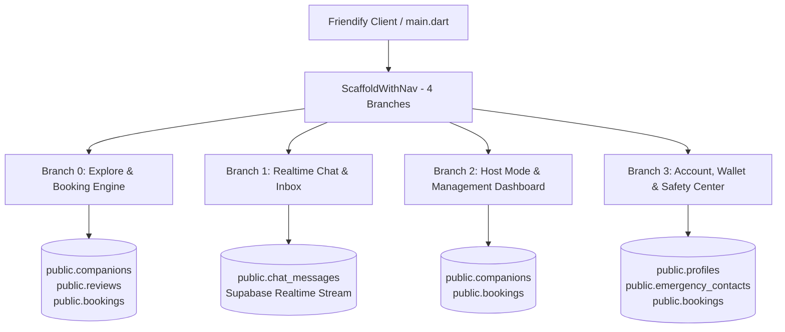

# Friendify — Full Tab-by-Tab Production Implementation Roadmap

This directory contains the complete, production-grade implementation blueprints for all 4 main tabs in **Friendify**. Every feature is mapped end-to-end to **Supabase Database & Realtime** and **Flutter Riverpod State Management**.

---

## Architecture Overview

---

## Tab Implementation Documents

| Document | Tab | Key Features & Modules | Supabase Tables Used |
| :--- | :--- | :--- | :--- |
| [01_tab_explore_and_booking.md](file:///d:/Android%20Projects/friendify/plans/01_tab_explore_and_booking.md) | **Tab 1: Explore** | Live companions feed, 3 view modes (Grid, List, Stack), multi-parameter search & filters, profile gallery, community reviews with DB rating trigger, and 4-step escrow booking flow. | `companions`, `reviews`, `bookings` |
| [02_tab_realtime_chat.md](file:///d:/Android%20Projects/friendify/plans/02_tab_realtime_chat.md) | **Tab 2: Chat** | Live inbox threads, Supabase Realtime message stream, text/location/voice payloads, read receipts, and safety SOS sheet integration. | `chat_messages`, `companions` |
| [03_tab_host_mode_dashboard.md](file:///d:/Android%20Projects/friendify/plans/03_tab_host_mode_dashboard.md) | **Tab 3: Host** | Host status detection, Online/Offline availability toggle (`is_active`), escrow earnings card, hourly rate quick editor, public listing preview, and 4-step host onboarding application. | `companions`, `profiles`, `bookings` |
| [04_tab_account_wallet_safety.md](file:///d:/Android%20Projects/friendify/plans/04_tab_account_wallet_safety.md) | **Tab 4: Account** | Supabase Auth (email/password/guest), wallet deposits & withdrawals, bookings manager (Upcoming, Past, Canceled), post-meetup rating dialog, emergency contacts CRUD, and Trust & Safety Center. | `profiles`, `emergency_contacts`, `bookings`, `reviews` |

---

## Execution Methodology

To ensure 100% stability and zero regressions:
1. **One Tab at a Time**: Complete and test each tab thoroughly before moving to the next.
2. **Real Database Operations**: Zero hardcoded mock data fallbacks in happy paths; all records persist to Supabase PostgreSQL.
3. **Reactive Riverpod Providers**: State changes in one tab (e.g., booking a friend in Tab 1) instantly reflect across the other tabs (appearing in Tab 4 Account bookings and Tab 2 Chat threads).
4. **Continuous Quality Gate**: Every tab implementation must pass `flutter analyze` with 0 warnings and `flutter test` across all 28+ test suites.
